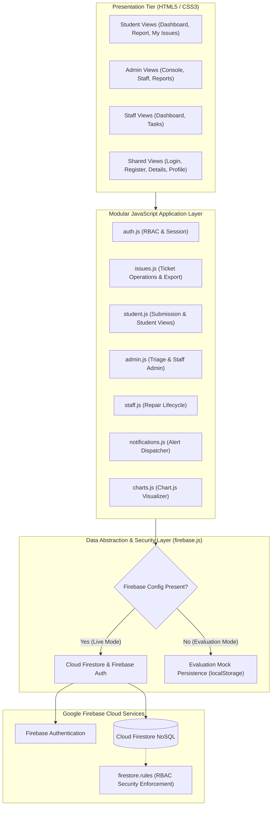
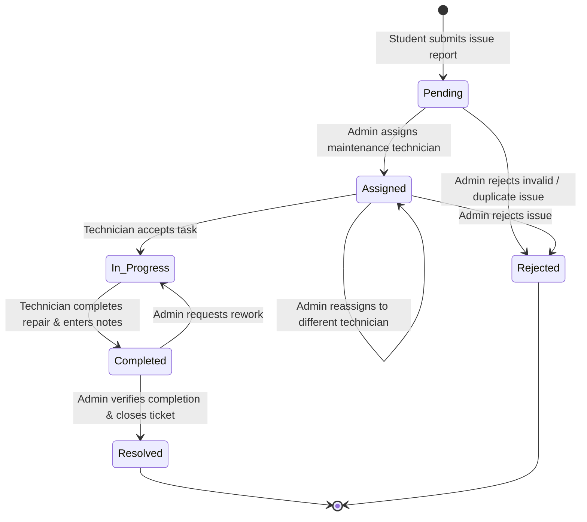
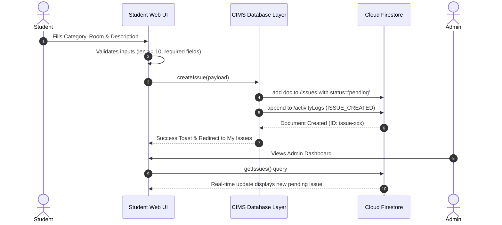
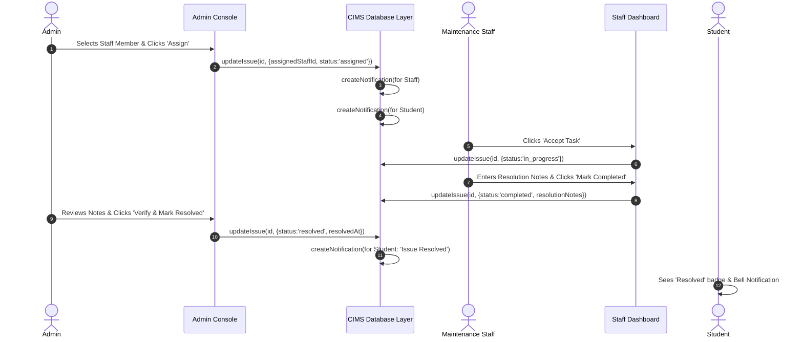

# Classroom Issue Management System (CIMS)
## System Design & Architecture Document
**Course:** Software Development Fundamentals (SDF)  
**Standard:** Modular Clean Architecture & Firebase Cloud Integration  

---

## 1. System Architecture Overview

CIMS follows a decoupled, three-tier modular architecture designed for performance, security, and academic clarity:

---

## 2. Database Schema (Cloud Firestore)

### 2.1 Collection: `users`
Stores user identity profiles, role designations, and institutional details.

| Field Name | Type | Description | Example |
| :--- | :--- | :--- | :--- |
| `uid` | String | Unique document ID (matches Auth UID) | `"student-001"` |
| `fullName` | String | User's full legal name | `"Aarav Gupta"` |
| `email` | String | Official college email address | `"aarav.student@college.edu"` |
| `role` | String | Authorization role: `'student'`, `'admin'`, `'staff'` | `"student"` |
| `studentId` | String | College Roll / Student ID (if student) | `"CS2023045"` |
| `staffId` | String | Employee / Technician ID (if staff) | `"STF-101"` |
| `department` | String | Academic department or maintenance division | `"Computer Science & Engineering"` |
| `specialization` | String | Technical specialization (if staff) | `"Projectors, AV & Electrical"` |
| `phone` | String | Contact phone number | `"+91 98111 22334"` |
| `createdAt` | ISO String / Timestamp | User profile creation timestamp | `"2024-01-10T09:00:00Z"` |

### 2.2 Collection: `issues`
Represents individual classroom defect reports and their operational lifecycle.

| Field Name | Type | Description | Example |
| :--- | :--- | :--- | :--- |
| `id` | String | Unique Firestore Document ID | `"issue-2024-001"` |
| `issueCode` | String | Human-readable tracking identifier | `"CIMS-2024-001"` |
| `studentId` | String | UID of reporting student | `"student-001"` |
| `studentName` | String | Full name of student | `"Aarav Gupta"` |
| `studentEmail` | String | Email of student | `"aarav.student@college.edu"` |
| `category` | String | Issue category: `'Projector'`, `'Fan'`, `'Lighting'`, `'Wi-Fi'`, `'Benches and furniture'`, `'Electrical problems'`, `'Cleanliness'`, `'Other'` | `"Projector"` |
| `classroomNumber` | String | Classroom or lab identifier | `"CS-Lab-3"` |
| `description` | String | Detailed symptom description | `"The ceiling projector lamp flickers violently..."` |
| `priority` | String | Urgency level: `'low'`, `'medium'`, `'high'`, `'urgent'` | `"high"` |
| `status` | String | Ticket status: `'pending'`, `'assigned'`, `'in_progress'`, `'completed'`, `'resolved'`, `'rejected'` | `"in_progress"` |
| `assignedStaffId` | String / Null | UID of assigned maintenance technician | `"staff-101"` |
| `assignedStaffName` | String / Null | Full name of assigned technician | `"Ramesh Sharma"` |
| `assignedAt` | ISO String / Null | Timestamp when staff was assigned | `"2024-02-01T10:30:00Z"` |
| `resolutionNotes` | String | Technician repair findings and actions | `"Replacement lamp bulb requisitioned from store."` |
| `resolvedAt` | ISO String / Null | Timestamp when marked resolved by admin | `"2024-02-02T16:00:00Z"` |
| `createdAt` | ISO String / Timestamp | Timestamp when ticket was created | `"2024-02-01T08:00:00Z"` |
| `updatedAt` | ISO String / Timestamp | Timestamp of latest state change | `"2024-02-01T14:00:00Z"` |

### 2.3 Collection: `activityLogs`
Immutable audit log recording every transition, assignment, and priority modification.

| Field Name | Type | Description | Example |
| :--- | :--- | :--- | :--- |
| `id` | String | Unique log record ID | `"log-101"` |
| `issueId` | String | Target issue document ID | `"issue-2024-001"` |
| `action` | String | Action code: `'ISSUE_CREATED'`, `'STAFF_ASSIGNED'`, `'STATUS_UPDATED'`, `'NOTES_ADDED'`, `'WORK_COMPLETED'`, `'ISSUE_RESOLVED'`, `'ISSUE_REJECTED'` | `"STAFF_ASSIGNED"` |
| `performedBy` | String | Actor's display name | `"Prof. Vikram Malhotra"` |
| `performedByUid` | String | Actor's UID | `"admin-001"` |
| `performedByRole` | String | Actor's role at time of action | `"admin"` |
| `details` | String | Human-readable explanation of modification | `"Assigned to technician Ramesh Sharma."` |
| `timestamp` | ISO String / Timestamp | Timestamp of action | `"2024-02-01T10:30:00Z"` |

### 2.4 Collection: `notifications`
Targeted real-time user notifications.

| Field Name | Type | Description | Example |
| :--- | :--- | :--- | :--- |
| `id` | String | Unique notification ID | `"notif-501"` |
| `userId` | String | Recipient UID | `"student-001"` |
| `title` | String | Concise notification heading | `"Issue In Progress"` |
| `message` | String | Informational message body | `"Your complaint CIMS-2024-001 is being serviced."` |
| `issueId` | String | Associated issue ID for quick click navigation | `"issue-2024-001"` |
| `isRead` | Boolean | Read/unread flag | `false` |
| `createdAt` | ISO String / Timestamp | Creation timestamp | `"2024-02-01T11:00:00Z"` |

---

## 3. Issue Lifecycle State Machine

The issue follows a strict, controlled state transition workflow:

### State Definitions:
1. **Pending:** Initial state when a student logs a complaint. No maintenance staff is yet assigned.
2. **Assigned:** Campus facility administrator has reviewed the complaint, chosen priority, and delegated it to a technician.
3. **In Progress:** Technician has accepted the work order and initiated diagnostic or physical repair.
4. **Completed:** Technician has completed physical repair work, recorded resolution notes, and submitted for review.
5. **Resolved:** Administrator has verified that equipment is operational and closed the ticket. Student is notified.
6. **Rejected:** Ticket is determined to be invalid, duplicate, or non-actionable with documented justification.

---

## 4. Sequence Diagrams

### 4.1 Issue Creation & Notification Workflow

### 4.2 Maintenance Assignment & Repair Completion Workflow

---

## 5. Role-Based Access Control (RBAC) Matrix

| Operation / Asset | Student | Maintenance Staff | Facility Administrator |
| :--- | :---: | :---: | :---: |
| Self-Registration | Yes (strictly as student) | No (provisioned by admin) | No (restricted setup) |
| View Own Reported Issues | **Yes** | N/A | **Yes** (all campus issues) |
| View Other Students' Issues | **DENIED** | **DENIED** | **Yes** |
| Submit New Issue | **Yes** | No | **Yes** |
| Assign / Reassign Staff | **DENIED** | **DENIED** | **Yes** |
| Change Issue Priority | **DENIED** | **DENIED** | **Yes** |
| Accept Assigned Task | **DENIED** | **Yes** (own queue) | **Yes** |
| Update Resolution Notes | **DENIED** | **Yes** (own queue) | **Yes** |
| Mark Task Completed | **DENIED** | **Yes** (own queue) | **Yes** |
| Mark Issue Resolved | **DENIED** | **DENIED** | **Yes** |
| Reject Issue | **DENIED** | **DENIED** | **Yes** |
| Provision Staff Accounts | **DENIED** | **DENIED** | **Yes** |
| View System Analytics | **DENIED** | **DENIED** | **Yes** |
| Export CSV Audit Data | **DENIED** | **DENIED** | **Yes** |
